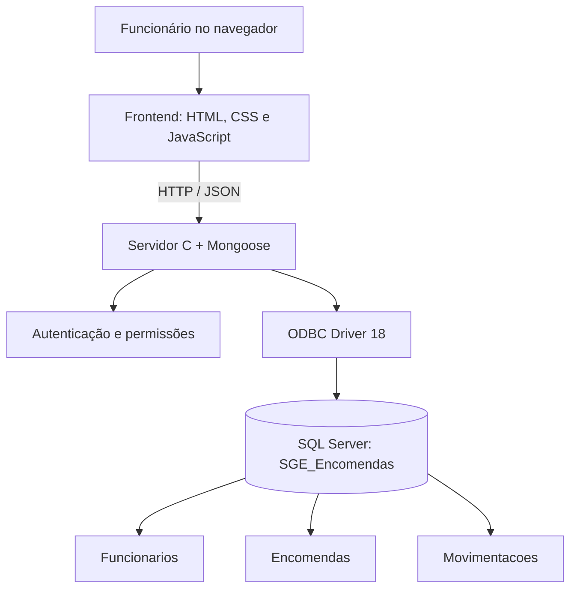

# Arquitetura do SGE

## Visão geral

O projeto adota uma arquitetura simples em camadas. A interface não acessa o banco diretamente: ela envia requisições HTTP para o servidor C, e o servidor valida a operação antes de consultar ou atualizar o SQL Server.

## Responsabilidade de cada parte

### Frontend

`frontend/index.html` define a estrutura das páginas; `frontend/style.css` controla o layout; `frontend/script.js` responde aos cliques e formulários, envia requisições HTTP/JSON e atualiza a tela com as respostas da API. Esconder uma opção na interface não é considerado uma regra de segurança suficiente.

### Servidor C

`backend/src/server.c` hospeda os arquivos do frontend e implementa os endpoints. O servidor trata autenticação, sessões, troca de senha, validação de cargo, validação de dados e acesso ao banco por ODBC. Operações sensíveis são verificadas no backend.

### Banco de dados

O SQL Server mantém os registros duráveis. As três tabelas centrais são:

- `Funcionarios`: identidade do funcionário, cargo, setor, status ativo e dados de autenticação.
- `Encomendas`: dados da encomenda e referência ao funcionário responsável.
- `Movimentacoes`: histórico das etapas do fluxo de uma encomenda.

A coluna `Encomendas.FuncionarioResponsavelId` estabelece o relacionamento com `Funcionarios.Id`. As movimentações relacionam-se à encomenda por `EncomendaId` e podem registrar o funcionário que realizou a operação.

## Fluxo de uma consulta

1. O funcionário abre uma tela ou realiza uma ação.
2. O JavaScript envia uma requisição para uma rota `/api/...`.
3. O servidor valida sessão e permissões para a operação.
4. O servidor executa uma consulta SQL parametrizada usando ODBC.
5. O SQL Server devolve o resultado.
6. O servidor responde em JSON e o JavaScript atualiza a interface.

## Fluxo resumido de cadastro

Formulário → validação no navegador → `POST /api/encomendas` → validação de sessão/cargo no servidor → comando SQL parametrizado → confirmação ao navegador → atualização da lista.

## Fluxo de atualização de status

A API verifica se o usuário pode avançar o estado e se a próxima etapa é permitida. A alteração do status e o registro da movimentação são feitos de forma transacional; se a operação não puder ser concluída, o servidor tenta reverter a transação.

## Observação

O diagrama descreve a arquitetura lógica do protótipo, não um ambiente de produção. O servidor é local e o SQL Server usa uma configuração de desenvolvimento.
